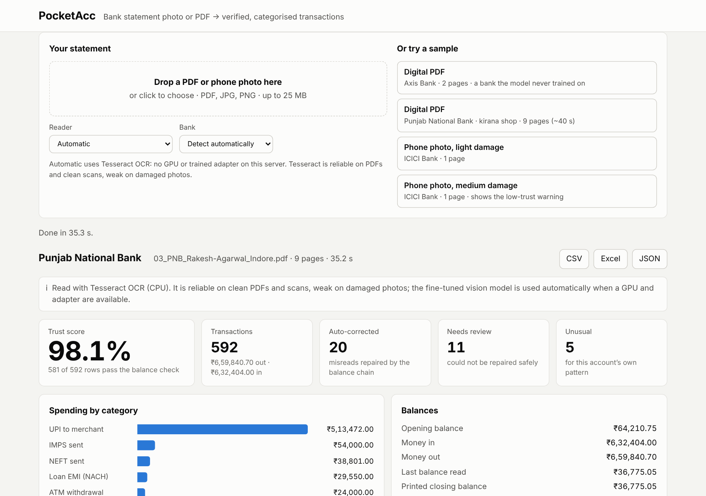

# PocketAcc — self-verifying extraction of Indian bank statements

Turn a scanned or phone-photographed Indian bank statement into clean, structured, categorised
transactions — and know which numbers to trust.

* **Reads** the page with a small vision-language model (Qwen2-VL-2B) fine-tuned with **QLoRA** on a 6 GB GPU
* **Verifies** every row with the statement's own arithmetic: `previous balance − debit + credit = balance`
* **Corrects** misread digits (3↔8, 1↔7, dropped digits, swapped columns) and flags anything it cannot prove
* **Categorises** transactions with classical ML (TF-IDF + Linear SVM) and flags unusual ones (Isolation Forest + rules)
* **Web app**: upload a PDF or photo → table with corrected / needs-review / unusual rows, trust score, spending by category, CSV / Excel / JSON

Mini-project, CSET312, Bennett University — Ansh Singh, Navya Khandelwal.

---

## Pipeline

| Step | What | Code |
|---|---|---|
| 1 | Synthetic statements for 7 banks with page-level ground truth | `src/generate.py` |
| 2 | Domain-randomised damage (desk, rotation, perspective, blur, shadow, stamp, noise, JPEG) | `src/degrade.py` |
| 3 | Classical pre-processing: paper crop (Otsu + contours), deskew (Hough), resize to the VLM patch grid | `src/preprocess.py` |
| 4 | Page → JSON dataset, QLoRA fine-tuning, extraction, evaluation | `src/build_dataset.py`, `src/finetune.py`, `src/extract.py`, `src/evaluate.py` |
| 5a | Vision-model output repair: tolerant JSON parsing, values put back in their columns | `src/common.py`, `src/rowfix.py` |
| 5–6 | Balance-chain verification and correction | `src/corrector.py` |
| 7 | Transaction classifier (LR / NB / Linear SVM / RF) | `src/classifier.py` |
| 8 | Unusual-transaction detection: Isolation Forest on per-account features + duplicate-debit and robust z-score rules | `src/anomaly.py` |
| 10 | Web app: FastAPI + dashboard + Docker | `src/pipeline.py`, `src/app.py`, `src/static/index.html`, `Dockerfile` |
| — | Traditional baseline: Tesseract OCR + rule-based parser | `src/ocr_baseline.py` |

## Data

| Set | Statements | Pages | Transactions | Notes |
|---|---|---|---|---|
| `data/original` | 20 | 110 | 4,774 | first hand-built set, 7 banks, 21 categories |
| `data/generated` | 140 | 460 | 15,368 | `generate.py --n 140 --seed 7`, 20 per bank, page numbers recorded |

All statements are synthetic — no real customer data. Every balance chain in both sets is verified (0 errors).

**Experiment split** (`build_dataset.py`): train on HDFC, SBI, PNB, Kotak (generated, clean + 2 damaged copies per page);
`test_seen` = the original hand-made statements of those banks; `test_unseen` = ICICI, Bank of Baroda, Axis — never seen in training.

## Results so far

| Component | Result |
|---|---|
| Balance corrector (simulation, 5% of rows with injected digit errors) | numeric field accuracy 97.5% → **99.7%**; 90.2% auto-fixed, 9.4% flagged, 0% missed, 0.4% wrong fixes |
| Transaction classifier, original data, unseen bank | Linear SVM **95.7%** accuracy (LR 94.5, NB 84.3, RF 68.8) |
| Unusual transactions (1% injected, leave-one-statement-out) | hybrid: AUC **95.6**, recall **61.9%** at 1.2% false alarms (3-sigma rule: AUC 92.6, recall 41.9%, 0.5%) |
| Deskew (heavy damage) | mean tilt 1.53° → 0.57° |
| Tesseract OCR baseline (unseen banks) | amounts 89.8% on clean pages (**98.0%** with corrector), 3.2% on heavy damage |
| Whole app on a real 9-page PDF (PNB, 592 rows, Tesseract) | 98.1% of rows verified, closing balance matches, 574/592 rows exactly right, categories 592/592 |
| Qwen2-VL-2B QLoRA fine-tuning (Kaggle T4, 300 pages, 37 steps) | best validation loss **0.060**; adapter in `adapters/lora_r8` (8.7 MB) |
| Fine-tuned model vs Tesseract vs base model (same 24 test pages per split) | see the table below |

### Fine-tuned Qwen2-VL-2B vs the baselines

Same 24 test pages per split for every reader (8 pages × clean scan / medium-damage photo / heavy-damage photo),
after the balance corrector. `results/score24_*.json`; reproduce with `python src/evaluate.py score ... --limit 24`.

| Reader | Seen banks: rows found | Seen banks: amounts right | New banks: rows found | New banks: amounts right |
|---|---|---|---|---|
| Tesseract OCR + rule parser (traditional) | 46.2% | 42.7% | 64.0% | 59.2% |
| Qwen2-VL-2B, not fine-tuned (zero-shot) | 2.8% | 2.2% | 39.1% | 14.9% |
| Qwen2-VL-2B fine-tuned (QLoRA), model output as is | 79.8% | 48.0% | 71.9% | 61.8% |
| **Fine-tuned + step 5a post-processing (used in the app)** | **91.3%** | **61.4%** | **96.1%** | **89.0%** |

Heavy-damage phone photos, new banks, amounts right: Tesseract 5.1% → fine-tuned + 5a **95.6%**.
Step 5a (tolerant JSON parsing + re-aligning values with the balance arithmetic, `src/rowfix.py`) was added after an
error analysis of these outputs (`docs/FAILURES.md`) and re-scores the same saved outputs (`evaluate.py score --repair`,
`results/score24_*_rowfix.json`); because it was designed on these pages, the new demo statements are the fair check.

All earlier numbers: `docs/milestone2.md`.

## Setup

```bash
git clone https://github.com/anshace07/PocketAcc.git
cd PocketAcc
pip install -r requirements.txt
```
System tools: **Poppler** (for `pdf2image`) and, only for the OCR baseline, **Tesseract**.
Windows: download Poppler for Windows and add its `bin` folder to PATH; install Tesseract from the UB Mannheim build.

GPU (fine-tuning / inference):
```bash
# PyTorch with CUDA first - pick the command for your CUDA version at pytorch.org
pip install torch --index-url https://download.pytorch.org/whl/cu124
pip install -r requirements-gpu.txt
```

## Run

```bash
python src/generate.py --n 140 --out data/generated --seed 7      # step 1 (already done, PDFs in repo)
python src/build_dataset.py --out data/vlm                         # steps 2-4a: page images + JSON targets (~20 min)
python scripts/smoke_test.py data/vlm                              # CPU test of the training code
python scripts/check_4bit_vision.py                               # CPU test: in 4-bit the vision encoder still sees the real image
python scripts/vram_test.py --data data/vlm                        # GPU: will it fit?
python src/finetune.py --data data/vlm --out runs/lora_r8 --rank 8 --epochs 1
python src/evaluate.py predict --system vlm --adapter runs/lora_r8/best_adapter --split test_unseen --limit 24 --out results/ft_unseen.jsonl
python src/evaluate.py score results/ft_unseen.jsonl --split test_unseen
python src/extract.py some_statement.pdf --adapter runs/lora_r8/best_adapter --out result.json
```

No local GPU? Use **`notebooks/pocketacc_kaggle.ipynb`** on Kaggle (free T4 GPU) — it runs every step above.

Classical ML (CPU):
```bash
python src/classifier.py data/original/ground_truth.json --out results/classifier_original.json   # step 7
python src/anomaly.py --out results/anomaly.json                                                  # step 8
python scripts/corrector_sim.py data/original/ground_truth.json results/corrector_simulation.json # steps 5-6
```

## Web app (step 10)

```bash
pip install -r requirements.txt -r requirements-app.txt
uvicorn app:app --app-dir src --port 8000          # open http://localhost:8000
python scripts/test_app.py                         # end-to-end API test
python src/pipeline.py statement.pdf --csv out.csv --xlsx out.xlsx    # same pipeline, command line
```
or with Docker (CPU, Tesseract reader):
```bash
docker build -t pocketacc .
docker run -p 8000:8000 pocketacc
```
Upload a PDF or phone photo (or click a sample). The table marks rows **corrected** (green), **needs review** (red) and
**unusual** (amber), with the reason; export CSV, Excel or JSON. On a GPU machine with the trained adapter in
`runs/lora_r8/best_adapter`, the reader switches to the fine-tuned vision model automatically.



## Demo (fine-tuned model)

* `demo/samples/` – statements of a made-up bank layout the model never saw ("PocketAcc Demo Bank"), the first page as
  light / medium / heavy-damage phone photos, and an answer key (`scripts/make_demo_statements.py`)
* `notebooks/pocketacc_demo_kaggle.ipynb` – on Kaggle (GPU T4 x2): saves the fine-tuned model's results on the demo
  files (`scripts/run_demo.py`), reads any statement live (`scripts/demo_live.py`), or serves the web app with the
  fine-tuned model behind a public link (`scripts/start_public_app.py`)
* the web app shows those saved results under **Saved results**, next to the page image and the answer-key check
* `python scripts/build_demo_viewer.py` – the same dashboard as one offline HTML file with every saved result inside
* `python scripts/reprocess_saved.py` – re-run the steps after reading on saved model output (no GPU)

## Repository layout

```
src/        all pipeline code (each file explains itself at the top); static/ = dashboard page
scripts/    smoke_test.py, check_4bit_vision.py, vram_test.py, corrector_sim.py, test_app.py, demo scripts
adapters/   the trained LoRA adapter (lora_r8)
demo/       demo statements + answer key, saved results, offline results page
notebooks/  Kaggle notebook for GPU training
data/       original/ and generated/ statements + ground truth
results/    experiment outputs
docs/       milestone notes and FAILURES.md (what broke and how we fixed it)
```
